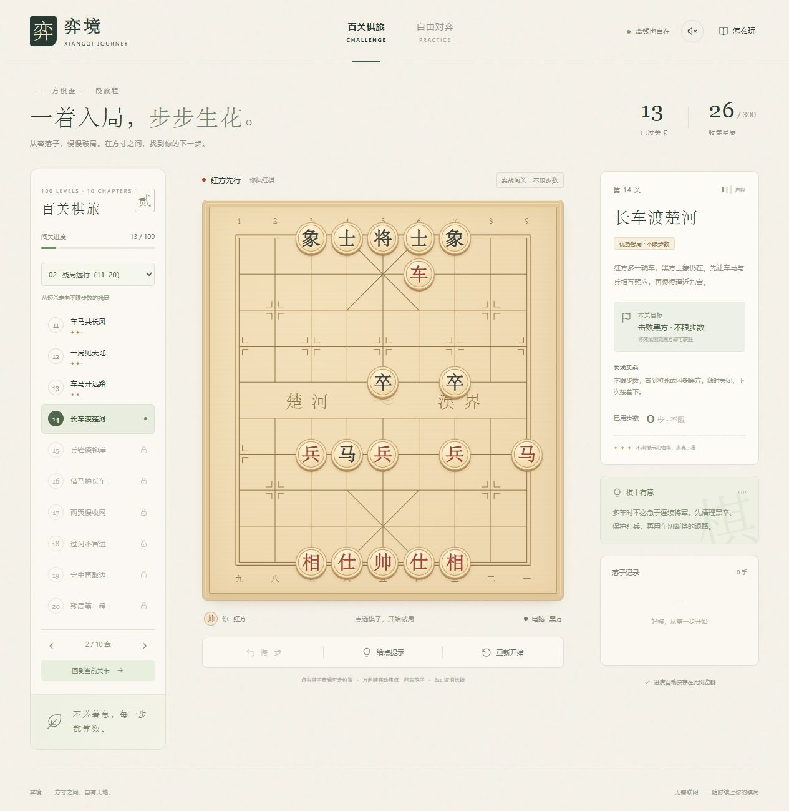

# 弈境 · 百关象棋

**一方棋盘，一段旅程。**

弈境是一款可离线游玩的中国象棋游戏。沿着 10 个章节挑战 100 个关卡，从经典杀法走向长线残局与完整对局，在每一盘棋中练习判断、配合与攻守。

下载游戏，双击打开，即可开始棋旅。无需安装，无需注册，下载后全程离线。

**[立即下载游戏](https://github.com/fading723/yijing-xiangqi/releases/latest/download/Yijing-Xiangqi.html)** · [下载压缩包](https://github.com/fading723/yijing-xiangqi/releases/latest/download/Yijing-Xiangqi.zip) · [版本更新](https://github.com/fading723/yijing-xiangqi/releases/latest) · [开始游玩](#开始游玩)



## 游戏特色

| 功能 | 说明 |
| --- | --- |
| 新手引导 | 首次打开介绍选棋、落子和闯关，随时查看棋子走法 |
| 百关棋旅 | 100 个固定关卡、10 个章节，通关后逐步解锁 |
| 渐进挑战 | 从多子优势到均势对弈，电脑棋力随章节提升 |
| 长线实战 | 第 13～100 关不限步数，持续对弈至分出胜负 |
| 自由对弈 | 标准开局，提供入门、进阶、挑战三档电脑棋力 |
| 走法辅助 | 合法落点提示、将军提醒、走法建议和整轮悔棋 |
| 三星收集 | 每关最多 3 星，总计 300 星，重复挑战保留最佳成绩 |
| 自动续局 | 保存关卡、星数、当前棋局和设置，随时接着下 |
| 完整离线 | 棋盘、关卡、电脑计算、提示和音效均在本地运行 |
| 多端布局 | 适配桌面与手机屏幕，支持鼠标、触屏和键盘操作 |

## 开始游玩

1. 点击 **[立即下载游戏](https://github.com/fading723/yijing-xiangqi/releases/latest/download/Yijing-Xiangqi.html)**，保存 `Yijing-Xiangqi.html`。
2. **双击下载的文件**，浏览器打开后，点击「开始下棋」。
3. 点一枚红棋，再点亮起的位置落子，开始挑战。

支持 Windows、macOS 和 Linux 电脑，推荐使用 Edge、Chrome 或 Firefox。若双击没有进入游戏，右键选择「打开方式」，再选择浏览器。

也可以 **[下载压缩包](https://github.com/fading723/yijing-xiangqi/releases/latest/download/Yijing-Xiangqi.zip)**，解压后双击 **`开始游戏.html`**。压缩包附有中文《怎么玩》，可以直接分享给亲友。

游戏采用单文件打包，电脑对手、提示、音效和存档均可离线使用。Release 页的 **Assets** 提供游戏文件；选择上面的下载按钮即可直接获取成品。

### 基本操作

- **落子**：点选红方棋子，再点击亮起的位置。
- **给点提示**：查看建议走法和棋盘上的指引箭头。
- **悔一步**：撤销你与电脑最近的一轮落子。
- **重新开始**：重置当前关卡或对局。
- **章节切换**：使用选章菜单或翻页按钮浏览关卡。
- **音效**：点击右上角声音按钮切换。
- **键盘**：方向键移动棋盘焦点，回车选择或落子，`Esc` 取消选择。

### 星数评价

| 本次通关方式 | 获得星数 |
| --- | --- |
| 独立完成 | ★★★ |
| 使用提示或悔棋中的一项 | ★★ |
| 同时使用提示与悔棋 | ★ |

已通关的关卡可以反复挑战，星数保留最高记录。

## 关卡旅程

前 12 关以 1～3 步的经典杀法建立基础。第 13 关起进入不限步数的实战，逐步增加子力配合、攻守转换和长局经营的要求。

| 章节 | 关卡 | 主题 |
| --- | --- | --- |
| 初识杀法 | 1～10 | 封路、将军与经典子力配合 |
| 残局远行 | 11～20 | 从入门试炼走向长线优势残局 |
| 兵锋渐进 | 21～30 | 组织兵线，经营多子优势 |
| 车马纵横 | 31～40 | 寻找马位，协调车马炮 |
| 炮火相济 | 41～50 | 双车调动与炮架配合 |
| 中盘磨砺 | 51～60 | 阵型经营与兵力优势转化 |
| 攻守兼修 | 61～70 | 小优势下的攻防判断 |
| 均势争锋 | 71～80 | 同等子力下争夺主动 |
| 布局深耕 | 81～90 | 从布局出发，贯通中局与收官 |
| 百局归心 | 91～100 | 完整对局与终章挑战 |

## 对局规则

棋子遵循中国象棋的行棋规则，包括九宫、过河、蹩马腿、塞象眼、炮架与将帅照面。落子后须确保己方将帅安全。

- 将死对手，或使对手无合法走法，即为获胜。
- 教学杀法关需在指定红方步数内获胜；实战关按对局胜负结算。
- 同一局面第三次出现时判和；由一方连续将军造成的重复，判将军方负。
- 连续 120 手未吃子时判和，红、黑每次落子各计一手。
- 闯关获胜后解锁下一关；和棋后可悔棋继续探索，或重新挑战。

## 自动存档

进度保存在当前浏览器的本地存储中。使用同一浏览器、同一文件位置打开游戏，即可继续棋局。

更新时先关闭游戏，用新版文件替换原位置的同名 HTML，再用原来的浏览器打开。使用普通浏览窗口并保留浏览器本地数据，可以持续保存进度。

闯关与自由对弈分别保存棋局，星数、音效和电脑棋力设置一并保存。100 关版本自动承接原版 12 关的进度，并保留原存档。

## 本地开发

项目使用原生 HTML、CSS 和 JavaScript。开发工具需要 **Node.js 20 或更新版本**，推荐 Node.js 24。

```bash
# 运行自动化检查
npm test

# 构建单文件离线版
npm run build

# 制作供玩家下载的 HTML、ZIP 和校验文件
npm run package

# 启动本机预览
npm run preview

# 根据关卡设计重建实战目录
npm run campaign
```

预览地址：<http://127.0.0.1:8765>。

开发命令使用 Node.js 内置模块，直接运行即可。修改源码后执行 `npm run build`，更新 `弈境-离线版.html`。

`npm run package` 在 `dist/` 生成 `Yijing-Xiangqi.html`、`Yijing-Xiangqi.zip` 和 `SHA256SUMS.txt`。ZIP 中包含完整的 `开始游戏.html` 和 `怎么玩.txt`，采用 UTF-8 文件名与固定时间戳，可重复构建。

### 项目结构

```text
├── index.html                页面入口
├── style.css                 棋盘与响应式界面
├── app.js                    交互、关卡、存档与音效
├── engine.js                 走法规则、胜负判断与电脑搜索
├── levels.js                 教学残局与关卡目录
├── campaign-design.js        章节设计与难度配置
├── campaign-data.js          实战关卡数据
├── 弈境-离线版.html          单文件游戏
├── docs/images/              游戏截图
├── scripts/                  构建、预览与关卡生成
└── tests/                    自动化检查
```

### 质量检查

自动化检查覆盖棋子规则、将帅安全、胜负判定、100 关目录、关卡去重、连续对弈、提示与悔棋、章节解锁、旧存档迁移及离线打包。GitHub Actions 会在提交和拉取请求时运行检查，并验证离线文件与源码一致。
